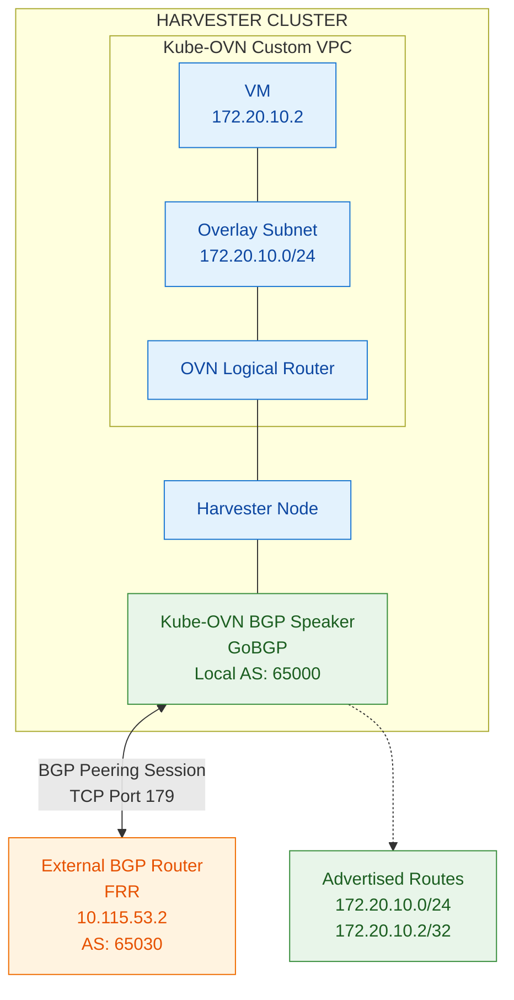

# Why is the Kube-OVN BGP Speaker Required?

## 1. Purpose

The Kube-OVN BGP Speaker enables Harvester/Kube-OVN networks to communicate routing information with external networks using the Border Gateway Protocol (BGP).

Consider a scenario where a VM runs inside a Kube-OVN overlay subnet:

- Overlay subnet: `172.20.10.0/24`
- VM IP: `172.20.10.2`
- External network: `10.115.48.0/21`
- External BGP router: `10.115.53.2`
- Harvester BGP AS: `65000`
- External BGP AS: `65030`

The external network does not automatically know how to reach the VM's overlay subnet. Although the OVN Logical Router provides connectivity within the Kube-OVN network, external routers need to learn routes to reach these VM addresses.

**This is where the Kube-OVN BGP Speaker becomes necessary.**

## 2. Why do we need a BGP Speaker?

Without a BGP Speaker, the external router has no automatic mechanism to learn routes to the Kube-OVN overlay networks.

We could configure static routes on the external router, but this introduces operational overhead:

- Every new overlay subnet may require a corresponding static route.
- Changes to VM or subnet networks require manual routing updates.
- Managing routes across multiple Harvester nodes and external routers becomes difficult.

The BGP Speaker automates this process by advertising the relevant Kube-OVN network routes to external BGP peers.

For example, it can advertise:

- `172.20.10.0/24` — the entire overlay subnet.
- `172.20.10.2/32` — an individual VM address.

The external router learns these routes dynamically and can forward traffic towards the Harvester cluster.

## 3. How does the BGP Speaker communicate with an external router?

The Kube-OVN BGP Speaker runs as a DaemonSet on selected Harvester nodes. It uses GoBGP to establish BGP peering sessions with external BGP routers.

The communication happens in the following sequence:

1. The BGP Speaker runs on a selected Harvester node.
2. It uses the configured local Autonomous System Number (AS), neighbor IP address and neighbor AS number.
3. It establishes a BGP peering session with the external router over the underlay network.
4. Once the BGP session is established, the speaker advertises the configured Kube-OVN overlay routes.
5. The external router receives the advertisements and installs the routes in its routing table.
6. External traffic destined for the overlay subnet can now be routed towards the Harvester cluster.

### Architecture Diagram

## 4. BGP Peering Configuration Example

| Parameter | Harvester | External Router |
|---|---|---|
| BGP Speaker | Kube-OVN GoBGP | FRR |
| IP Address | 10.115.48.4 | 10.115.53.2 |
| Local AS | 65000 | 65030 |
| Neighbor AS | 65030 | 65000 |
| Neighbor Address | 10.115.53.2 | 10.115.48.4 |

The BGP session is established between the Harvester BGP Speaker and the external FRR router.

## 5. Important distinction: BGP Control Plane vs Data Plane

It is important to understand that the BGP Speaker is responsible for exchanging routing information, not forwarding VM traffic itself.

- **Control Plane:** GoBGP establishes BGP sessions and advertises overlay network routes to external routers.
- **Data Plane:** OVN, the Harvester networking infrastructure and the external network forward actual packets based on the installed routes.

For example, when an external machine wants to communicate with `172.20.10.2`, the external router uses the route learned through BGP to forward traffic towards Harvester. The Harvester networking infrastructure then delivers the traffic to the appropriate VM.

**In summary:** The Kube-OVN BGP Speaker bridges the routing-information gap between Kube-OVN overlay networks and external networks. It allows external routers to dynamically learn how to reach VM and subnet IP addresses without requiring manually maintained static routes.
