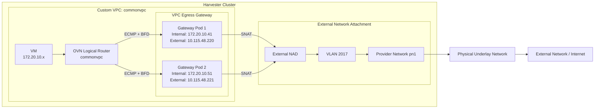

# Kube-OVN VPC Egress Gateway: Architecture, Configuration and High Availability

## 1. Introduction

The Kube-OVN VPC Egress Gateway provides external network connectivity to workloads running inside a custom VPC. It allows VMs and Pods in selected VPC subnets to access external networks through dedicated gateway instances.

The gateway provides Source Network Address Translation (SNAT), translating the source IP address of outgoing traffic from an internal workload to an external IP address assigned to the gateway.

Unlike a traditional single-instance NAT gateway, Kube-OVN VPC Egress Gateway supports multiple instances, ECMP-based traffic distribution, and BFD-based failure detection. This provides horizontal scaling and high availability.

In Harvester, this feature is useful when tenants need isolated VPC networks for their VMs but still require controlled outbound access to external networks, such as the Internet or an enterprise underlay network.

**Important capability limitation:**

VPC Egress Gateway currently supports **egress SNAT only**. It does not support DNAT, or inbound NAT.

## 2. Architecture and How It Works

A VPC Egress Gateway consists of multiple gateway Pods. Each gateway Pod has two network interfaces:

1. **Internal interface (eth0):** Connected to the internal subnet within the custom VPC.
2. **External interface (net1):** Connected to the external physical network through the external subnet and its Network Attachment Definition.

The external interface uses the underlying network to reach external destinations.

When an internal VM sends traffic to an external destination:

1. The VM sends traffic through its internal VPC gateway.
2. OVN identifies the source subnet and evaluates the routing policies.
3. OVN selects one of the registered VPC Egress Gateway instances as the next hop.
4. The gateway receives the traffic on its internal interface.
5. The gateway performs SNAT using its external IP address.
6. The translated packet leaves through the external interface.
7. The external network routes the packet towards its destination.
8. The response returns to the gateway, where the reverse NAT translation is performed.
9. The response is forwarded back to the original VM.

This needs upstream fix https://github.com/kubeovn/kube-ovn/pull/7425 planned to be in v1.17.0

### 2.1 High-level architecture

The following diagram illustrates the architecture using the Harvester lab configuration.



The gateway instances are connected to both the internal VPC network and the external network. OVN uses the gateway internal IP addresses as next hops.

### 2.2 Traffic distribution using ECMP

When multiple gateway replicas are configured, Kube-OVN registers their internal IP addresses in the VPC routing configuration.

OVN uses source-address hashing to distribute traffic across the available gateway instances.

For example:

```text
Internal subnet: 172.20.10.0/24

Gateway 1:
  Internal IP: 172.20.10.41
  External IP: 10.115.48.220

Gateway 2:
  Internal IP: 172.20.10.51
  External IP: 10.115.48.221
```

The routing policy can contain both gateway IPs as next hops:

```text
ip4.src == 172.20.10.0/24
    reroute 172.20.10.41, 172.20.10.51
```

This allows traffic to be distributed across the two gateway instances.

Adding more replicas provides additional gateway capacity and horizontal throughput scaling.

### 2.3 BFD-based high availability

ECMP provides traffic distribution, but OVN also needs a mechanism to determine whether a gateway instance is healthy.
If a gateway becomes unhealthy, the traffic switches over to healthy gateway instances.

Kube-OVN uses Bidirectional Forwarding Detection (BFD) to monitor gateway reachability.

BFD sessions are established between the OVN Logical Router's dedicated BFD port and each gateway instance.

When a gateway becomes unreachable:

1. BFD detects the failure.
2. The corresponding BFD session transitions to DOWN.
3. OVN marks the associated next hop as unavailable.
4. Traffic is redirected through the remaining healthy gateway instances.

When the gateway becomes healthy again, its BFD session returns to UP and its next hop becomes available again.

 


This provides automatic failure detection and recovery without requiring manual routing changes.

## 3. Harvester Lab Configuration

The following steps describe how to configure and test the VPC Egress Gateway in Harvester using a custom VPC named `commonvpc`.

### Lab network details

| Component | Configuration |
|---|---|
| Custom VPC | commonvpc |
| Internal subnet | subnetinternal |
| Internal CIDR | 172.20.10.0/24 |
| Internal gateway | 172.20.10.1 |
| Internal NAD | vswitchinternal |
| Provider Network | pn1 |
| External VLAN | 2017 |
| External subnet | subnetexternal |
| External NAD | vswitchexternal |
| External CIDR | 10.115.48.0/21 |
| External gateway | 10.115.55.254 |
| Gateway replicas | 2 |
| External test destination | 8.8.8.8 |

## 4. Configuration Steps

### Step 1: Create the custom VPC and enable the BFD port

Create a custom VPC named `commonvpc`.

BFD-based high availability requires a dedicated BFD Logical Router Port (LRP) on the custom VPC.

Configure the VPC with `bfdPort` enabled:

```yaml
apiVersion: kubeovn.io/v1
kind: Vpc
metadata:
  name: commonvpc
spec:
  bfdPort:
    enabled: true
    ip: 10.255.255.255
```

Apply the configuration:

```bash
kubectl apply -f commonvpc.yaml
```

**Why is the BFD port required?**

The BFD port provides a dedicated logical endpoint on the VPC router for establishing BFD sessions with the gateway instances.

Kube-OVN automatically creates the corresponding BFD logical router port when this feature is enabled.

The IP address `10.255.255.255` is used as the BFD peer address. Ensure that this address does not conflict with other addresses in the environment.

Verify the BFD port: exec into the ovn-central pod and use the following command

```bash
ovn-nbctl show commonvpc
```

Expected logical router port:

```text
router ... (commonvpc)
    port bfd@commonvpc
        networks: ["10.255.255.255"]
```

### Step 2: Configure the external network

The gateway requires an external network interface to communicate with the physical underlay network.

Configure the following components:

1. Create a Provider Network named `pn1`.
2. Create VLAN 2017 on the provider network.
3. Create an external Network Attachment Definition named `vswitchexternal`.
4. Create an external subnet named `subnetexternal`.
5. Attach the external subnet to the external NAD and VLAN 2017.
6. Associate the external subnet with the custom VPC `commonvpc`.

The external subnet configuration should use the following network information:

```text
External subnet: subnetexternal
Provider Network: pn1
VLAN: 2017
External NAD: vswitchexternal
CIDR: 10.115.48.0/21
Gateway: 10.115.55.254
VPC: commonvpc
```
The external NAD connects the gateway Pod to the external underlay network through the provider network and VLAN.

The external subnet supplies the external IP addresses used by the gateway instances.

https://docs.harvesterhci.io/v1.10/networking/kubeovn-vpcnatgateway#create-an-external-network

### Step 3: Configure the internal network

Create an internal Network Attachment Definition named `vswitchinternal`.

Create an internal subnet named `subnetinternal` and attach it to:

- NAD: `vswitchinternal`
- VPC: `commonvpc`

Configure the internal network:

```text
Internal subnet: subnetinternal
Internal NAD: vswitchinternal
CIDR: 172.20.10.0/24
Gateway: 172.20.10.1
VPC: commonvpc
```
https://docs.harvesterhci.io/v1.10/networking/kubeovn-vpcnatgateway#create-a-tenant-network

Create a VM in Harvester and attach its network interface to the `vswitchinternal` network.

The VM should receive an IP address from the internal subnet.

For example:

```text
VM IP: 172.20.10.x
Gateway: 172.20.10.1
Network: subnetinternal
VPC: commonvpc
```

At this point, the internal and external networks are configured and the VM is connected to the custom VPC.

### Step 4: Create the VPC Egress Gateway

Create a VPC Egress Gateway resource named `gateway1`.

Configure two replicas and enable BFD.

The policy specifies that traffic originating from `subnetinternal` should use the gateway with SNAT enabled.

```yaml
apiVersion: kubeovn.io/v1
kind: VpcEgressGateway
metadata:
  name: gateway1
  namespace: default
spec:
  bfd:
    enabled: true
    minRX: 150
    minTX: 150
    multiplier: 3
  vpc: commonvpc
  replicas: 2
  externalSubnet: subnetexternal
  internalSubnet: subnetinternal
  policies:
    - snat: true
      subnets:
        - subnetinternal
```

Apply the configuration:

```bash
kubectl apply -f gateway1.yaml
```

**Explanation of the important fields:**

| Field | Purpose |
|---|---|
| `vpc` | Custom VPC where the gateway operates |
| `replicas` | Number of gateway instances |
| `internalSubnet` | Subnet used to connect gateway instances to the VPC |
| `externalSubnet` | Subnet used to connect gateway instances to the external network |
| `bfd.enabled` | Enables BFD health monitoring |
| `bfd.minRX` | Minimum BFD receive interval in milliseconds |
| `bfd.minTX` | Minimum BFD transmit interval in milliseconds |
| `bfd.multiplier` | Detection multiplier |
| `policies.snat` | Enables source NAT |
| `policies.subnets` | Specifies the internal subnet whose traffic uses the gateway |

With two replicas, Kube-OVN creates two gateway instances, each with an internal and an external interface.

The two gateway instances will have separate internal and external IP addresses.

### Step 5: Verify the VPC Egress Gateway

Check whether the VPC Egress Gateway resource has been created successfully.

```bash
kubectl get veg
```

For more information:

```bash
kubectl get veg gateway1 -o wide
```

Check the following:

- VPC is `commonvpc`.
- Replicas are 2.
- BFD is enabled.
- External subnet is `subnetexternal`.
- Phase is `Completed`.
- Ready is `true`.
- Two internal and external IP addresses are dynamically allocated. (if not specified by user)

Example:

```text
NAME      VPC        REPLICAS   BFD ENABLED   EXTERNAL SUBNET   PHASE       READY
gateway1  commonvpc  2          true          subnetexternal    Completed   true
```

Check the gateway Pods:

```bash
kubectl get pods -o wide
```

Or filter specifically for the gateway:

```bash
kubectl get pods \
  -l ovn.kubernetes.io/vpc-egress-gateway=gateway1 \
  -o wide
```

Both gateway Pods should be in the `Running` state and should be ready.

Check the Deployment:

```bash
kubectl get deployment gateway1
```

Expected:

```text
READY   UP-TO-DATE   AVAILABLE
2/2     2            2
```

You can also describe an individual gateway Pod to verify its interfaces:

```bash
kubectl describe pod <gateway-pod-name>
```

The expected network interfaces are:

| Interface | Network | Example IP |
|---|---|---|
| eth0 | Internal VPC network | 172.20.10.41 |
| net1 | External network | 10.115.48.220 |

The second gateway should have its own internal and external IP addresses.

### Step 6: Test external connectivity from the VM

Log in to the VM attached to `vswitchinternal`.

Verify the IP address and default gateway:

```bash
ip addr
ip route
```

Ping an external destination:

```bash
ping 8.8.8.8
```

If everything is configured correctly, the VM should be able to reach the external network through the VPC Egress Gateway.

To continuously test connectivity:

```bash
ping 8.8.8.8
```

You can also use:

```bash
fping -c 100 8.8.8.8
```

To verify SNAT, capture traffic on the gateway's external interface:

```bash
kubectl exec -it <gateway-pod-name> -c bfdd -- bash
```

Depending on the gateway image and available utilities, inspect the external interface and capture packets:

```bash
ip addr
tcpdump -i net1 -nn icmp
```

The outgoing ICMP request should have the gateway's external IP as its source address rather than the VM's internal IP.

For example:

```text
Before SNAT:
172.20.10.x > 8.8.8.8

After SNAT:
10.115.48.220 > 8.8.8.8
```

This confirms that the gateway is performing source NAT.

## 5. Verify BFD Configuration

After verifying external connectivity, check whether BFD sessions have been established between the VPC router and both gateway instances.

### Step 1: Inspect the OVN routing policies

Connect to the OVN Central Pod:

```bash
kubectl exec -it <ovn-central-pod> -n kube-system -- bash
```

List the routing policies:

```bash
ovn-nbctl lr-policy-list commonvpc
```

You should see routing policies that redirect traffic originating from the internal subnet to the gateway instances.

Example:

```text
Routing Policies

31000   ip4.dst == 172.20.10.0/24   allow

29100   ip4.src == ...   reroute
        172.20.10.41, 172.20.10.51   bfd
```

The important part is that both gateway internal IPs are registered as next hops and BFD monitoring is enabled.

### Step 2: Inspect BFD sessions

Run:

```bash
ovn-nbctl list bfd
```

You should see two BFD entries, one for each gateway instance.

Verify the following fields:

```text
dst_ip: "172.20.10.41"
logical_port: "bfd@commonvpc"
min_rx: 150
min_tx: 150
detect_mult: 3
status: up
```

And the corresponding entry for:

```text
dst_ip: "172.20.10.41"
```

```text
dst_ip: "172.20.10.51"
```

Both sessions should report:

```text
status: up
```

### Step 3: Check BFD from the gateway Pods

Check the BFD daemon status from each gateway instance:

```bash
kubectl exec -it <gateway-pod-name> -c bfdd -- bfdd-control status
```

Expected output should show an active session:

```text
There are 1 sessions:

Session 1
 id=1
 local=172.20.10.41
 remote=10.255.255.255
 state=Up
```

Repeat this for the second gateway Pod.

The BFD session should be in the `Up` state for both instances.

## 6. Test BFD Failure Detection and Gateway Failover

One of the important capabilities of the VPC Egress Gateway is automatic failure detection.

The following test demonstrates how OVN handles a gateway becoming unreachable.

### Step 1: Start fping from the VM which sends ping packets less than every second.
```
bash
sudo apt update
sudo apt install -y fping


fping -D -p 100 -l 8.8.8.8
```
-p <time in ms> sends ping packet every 100 milliseconds
-D Timestamp
-l sends in loop until interrupted

### Step 2: Identify both gateway instances

```bash
kubectl get pods -o wide
```

For example:

```text
gateway1-xxxxx   1/1   Running   ...   hp-46
gateway1-yyyyy   1/1   Running   ...   hp-65
```

Login into each of the Harvester hosts and start tcpdump on interface connected to external.

```
bash
tcpdump -xx -i <eno50> | grep google
```
Identify the gateway instance that is forwarding the traffic

### Step 3: Simulate a BFD failure

Enter the selected gateway Pod:

```bash
kubectl exec -it <gateway-pod-name> -- bash
```

Insert temporary firewall rules to block traffic on the internal interface:

```bash
iptables -I INPUT -i eth0 -j DROP
iptables -I OUTPUT -o eth0 -j DROP
iptables -I FORWARD -i eth0 -j DROP
```

This blocks communication through the internal interface and allows you to simulate an unreachable gateway.

### Step 4: Verify the switchover and traffic loss

Verify the tcpdump captures on both Harvester hosts involved in the failover and compare their timestamps. 
Calculate the time difference between the last packet captured on the old active Harvester host and the first packet captured on the new active Harvester host. 
The expected gap should be approximately 150 ms × 3 = 450 ms, based on the configured BFD interval of 150 ms and a detection multiplier of 3 in the VPC Egress Gateway given in the above example config.
The traffic loss depends on the bfd interval configured on the vpc egress gateway config. The above is just an example.

### Step 5: Verify BFD state

From OVN Central, run:

```bash
ovn-nbctl list bfd
```

The affected gateway's BFD session should transition to:

```text
status: down
```

The other gateway should remain:

```text
status: up
```

### Step 6: Restore the failed gateway

Remove the temporary firewall rules from the affected gateway Pod:

```bash
iptables -D INPUT -i eth0 -j DROP
iptables -D OUTPUT -o eth0 -j DROP
iptables -D FORWARD -i eth0 -j DROP
```

Check BFD again:

```bash
ovn-nbctl list bfd
```

The recovered gateway's session should return to:

```text
status: up
```

**Note:** These firewall rules are temporary test rules. Remove them after testing. If the Pod is restarted, the rules will also disappear with its network namespace.

## 7. Test Gateway Pod Failure and Recovery

In addition to testing BFD failure detection, we can test what happens when an actual gateway Pod is deleted.

This verifies that the Kubernetes Deployment and Kube-OVN controller maintain the configured replica count.

### Step 1: Identify the gateway Pods

```bash
kubectl get pods -o wide
```

### Step 2: Delete one gateway Pod

```bash
kubectl delete pod <gateway-pod-name>
```

### Step 3: Verify the routing policy

Immediately inspect the OVN routing policy:

```bash
ovn-nbctl lr-policy-list commonvpc
```

The deleted gateway's next hop should be removed from the routing policy.

### Step 4: Verify Deployment recovery

```bash
kubectl get pods -o wide
```

The Deployment should create a replacement Pod to maintain the configured replica count.

Wait until the replacement Pod reaches:

```text
READY   STATUS
1/1     Running
```

### Step 5: Verify route restoration

Run:

```bash
ovn-nbctl lr-policy-list commonvpc
```

Once the replacement gateway is ready and BFD is established, its internal IP should be added back to the routing policy.

This confirms that the gateway workload is automatically recovered and the OVN routing configuration is reconciled.

## 8. Summary

The Kube-OVN VPC Egress Gateway provides a scalable and highly available solution for outbound connectivity from custom VPC networks in Harvester.

The important capabilities demonstrated in this configuration are:

1. **Custom VPC integration:** Gateway instances are connected to the internal subnet and external underlay network.
2. **SNAT:** Internal VM traffic is translated to the gateway's external IP before leaving the cluster.
3. **Active-Active ECMP:** Multiple gateway instances are used as next hops to distribute traffic.
4. **BFD monitoring:** OVN continuously monitors gateway reachability.
5. **Automatic failover:** Unhealthy gateway next hops are removed from the routing configuration.
6. **Automatic recovery:** Healthy gateway instances are added back to the routing configuration.
7. **Horizontal scalability:** Additional gateway replicas can be deployed to increase outbound traffic capacity.

**Feature limitation:** VPC Egress Gateway currently supports egress SNAT only. It does not provide DNAT, or inbound NAT functionality.

This makes it suitable for tenant VMs that need controlled outbound access while retaining their private internal VPC addressing.

---

## References

- Kube-OVN v1.16.x – [VPC Egress Gateway documentation](https://kubeovn.github.io/docs/v1.16.x/en/vpc/vpc-egress-gateway/)
- Kube-OVN – [VPC Introduction](https://kubeovn.github.io/docs/v1.16.x/en/vpc/vpc/)

The architecture, BFD configuration, gateway deployment, and operational behavior described here follow the Kube-OVN documentation, with the configuration and test scenarios adapted to the Harvester lab environment.
